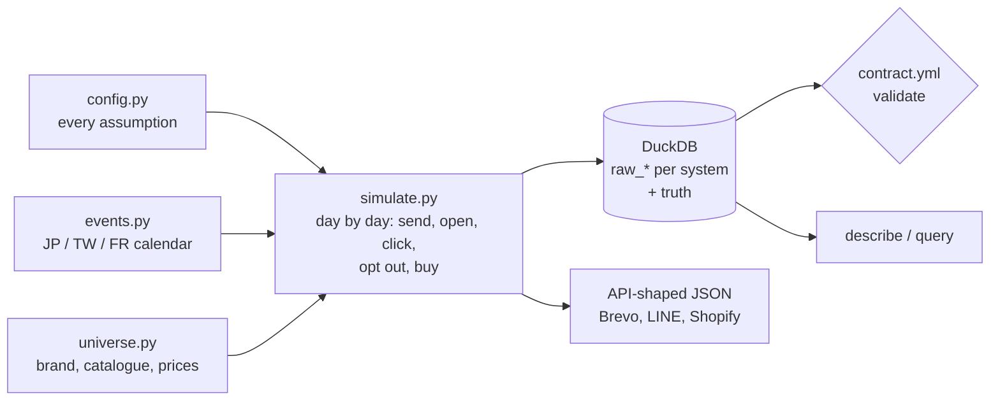

# Tsunagu つなぐ

[](https://github.com/thibaultbordrie-cloud/tsunagu/actions/workflows/ci.yml)


**A fictional cross-border CRM world, built to develop and test data pipelines and CRM agents without touching real customer data.**

*Tsunagu* means "to connect". The generator simulates **Lune & Lin** (月與亞麻 · リュヌ・エ・ラン), an invented French brand of linen stationery, tea and home goods that sells online in **France, Japan and Taiwan**. It writes what each tool of a real CRM stack would hold: e-mail campaigns (Brevo-like), a LINE Official Account (Messaging API-like), and online orders (Shopify-like). On top of that, it keeps **the answer key**: why every order really happened.

[日本語](#日本語での概要) · [繁體中文](#中文簡介繁體) · [Français](#en-bref-français)

## Why

CRM in Japan and Taiwan does not run on e-mail alone: LINE is the first channel, the commercial calendar is different (初売り, Golden Week, 雙11, 雙12, the shopping days before 春節), and prices follow local habits (¥2,980, NT$590). Public CRM datasets ignore all of that, and real customer data cannot be shared.

There is a second problem. To evaluate an analysis or an AI agent, you need to know the right answer. With real data, nobody knows which orders a campaign really caused. Here, the simulation knows.

## Quick start

```bash
git clone https://github.com/thibaultbordrie-cloud/tsunagu.git
cd tsunagu
python -m pip install -e ".[dev]"
tsunagu generate --scenario standard --out data/tsunagu.duckdb --api data/api   # about 20 s
tsunagu describe data/tsunagu.duckdb
```

```text
Lune & Lin (fictional) · orders from 2025-01-01 to 2026-10-31

market  buyers  orders  revenue EUR eq.  avg basket EUR  currency
FR        3179    7871           334181            42.5       EUR
JP        2368    5406           231971            42.9       JPY
TW        2313    5845           254267            43.5       TWD

Messages
market  channel  delivered  open %  open % w/o Apple MPP  click %  unsub %
FR        email     907147    47.8                  11.8     1.61    0.119
JP        email     366526    60.0                   7.7     0.86     0.15
JP         line     439464    42.3                  42.3     2.78        -
TW        email     125843    48.4                   7.3     0.79    0.142
TW         line     660967    35.7                  35.7     2.63        -
LINE friends who blocked the account by the end: JP 17.3 %, TW 25.3 %

What last-click says vs what really happened (answer key from the truth schema)
market  % orders with a campaign UTM  % orders truly caused  % of UTM orders truly caused
FR                               9.6                    6.2                          40.8
JP                              16.3                   10.7                          46.2
TW                              21.1                   13.8                          46.9
```

The last table is the point: last-click attribution credits campaigns with 10 to 21 % of orders, but fewer than half of those orders were really caused by the message.

**Worked example**: [did the e-mails really sell anything?](docs/EXAMPLES.md) Last-click, then the holdout groups with confidence intervals, then the answer key. With the default 5 % holdout the effect of e-mail cannot be detected; with `--set holdout_rate=0.2` it can, and the true value falls inside the interval.

```bash
tsunagu query data/tsunagu.duckdb examples/02_holdout_email_uplift.sql   # any SQL, read-only
tsunagu generate --set holdout_rate=0.2 --set 'line_friend={"TW": 0.9}'  # what-if: change any parameter
```

No time to run it? Browse a few API-shaped responses in [`samples/`](samples).

## How it works



## What is in the warehouse

| Schema | Tables | Like |
|---|---|---|
| `ref` | markets, 60 trilingual products, commercial calendar (141 events) | reference data |
| `raw_shop` | customers, orders, line items | Shopify Admin |
| `raw_email` | contacts, campaigns with statistics, event log, daily list sizes | Brevo |
| `raw_line` | message insights (aggregates only), click URLs, daily followers, follow / unfollow webhooks, LINE Login links | LINE Messaging API |
| `raw_crm` | the team's campaign plan, holdout groups | a planning sheet |
| `truth` | hidden traits, every message to every person, why each order happened, all parameters | **answer key, never for building** |

`--api` also writes the same data as API responses (`emailCampaigns`, `insight/message/event`, `insight/followers`, `orders.json`) so a connector can be built and tested offline. Shapes follow the public docs, simplified. Details: [docs/DATA_MODEL.md](docs/DATA_MODEL.md).

## What the simulation reproduces

- **Local commercial calendars**: 初売り, バレンタイン and ホワイトデー, Golden Week, お中元, お盆 (a dip), お歳暮; 年貨採買 before 春節 and the 春節 break (a dip), 618, 七夕, 中秋送禮, 週年慶, 雙11, 雙12; soldes, fête des mères, rentrée, Black Friday, Noël. Public holidays come from the `holidays` package; lunar dates are checked.
- **Local prices and currencies**: ¥2,980, NT$590, 16,90 €, with free-shipping thresholds per country.
- **Channel behaviour**: Apple Mail Privacy Protection inflates e-mail opens (60 % "open rate" in Japan, 7.7 % real); LINE is read far more than e-mail but friends block the account; frequency causes fatigue (fewer opens, more opt-outs).
- **A true causal effect with holdout groups**: 5 % of every audience is held out. Campaign effects are small and honest, so the holdout is sometimes too small to detect them: a real lesson in statistical power.
- **The attribution trap**: people who meant to buy anyway use the last message as a shortcut to the shop, so last-click over-credits campaigns.
- **Messy identity**: the e-mail tool stores some addresses with other case or stray spaces; only 70 % of LINE friends are linked to a shop account; LINE gives no per-user statistics at all.
- **Opt-outs are respected**: unsubscribed, bounced, complained or blocked people are never messaged again (tested).

Every behavioural number is an assumption, listed in [docs/ASSUMPTIONS.md](docs/ASSUMPTIONS.md) and set in one file, [`config.py`](src/tsunagu/config.py). It is a plausible world, not market data.

## Quality

- **Data contract** ([`contract.yml`](src/tsunagu/contract.yml)): keys, types, accepted values, relationships and business rules (`sent = delivered + bounces`, `unique_views = trackable_views + apple_mpp_opens`, totals add up). `tsunagu validate` checks it; a test proves it catches a broken total.
- **Tests**: same seed gives the same world; the calendar dates are right; realism properties hold; no order is ever caused by a campaign the customer was held out of; only `example.com` / `example.org` addresses, no phone numbers; an anonymity guard scans every file.
- **CI** builds the full two-year world on every push and publishes the summary.

## Roadmap

Tsunagu is the base of a larger project, built step by step:

1. **Fictional world** (this release): data, calendar, API shapes, contract, answer key.
2. **Cross-channel warehouse**: ingest the three sources, resolve identities, dbt models for e-mail vs LINE, holdout-based incrementality.
3. **Read-only MCP server**: give AI agents safe tools over the warehouse (KPIs, segments, calendar), with the same read-only locks as my question assistant.
4. **CRM agents, evaluated against the answer key**: a question assistant in French, English, Japanese and Traditional Chinese; a weekly analyst; a campaign planner that respects each country's calendar. Rules versus a local model, scores published.
5. **Write-ups** in Japanese and Traditional Chinese.

## 日本語での概要

Tsunagu（つなぐ）は、フランス・日本・台湾で販売する架空のブランド「リュヌ・エ・ラン（Lune & Lin）」のCRMデータを生成するツールです。メール配信（Brevo風）、LINE公式アカウント（Messaging API風）、ECサイトの注文（Shopify風）のデータを、各国の商習慣（初売り、ゴールデンウィーク、お中元、雙11、春節など）や価格表記（2,980円など）に合わせて再現します。すべて架空のデータで、実在の個人情報は一切含みません。

最大の特徴は「正解データ」があることです。どの注文がキャンペーンによって本当に生まれたのかが記録されているため、ラストクリック分析の過大評価を確かめたり、AIエージェントの分析が正しいかを検証したりできます。

## 中文簡介（繁體）

Tsunagu（つなぐ，意為「連結」）會為一個在法國、日本與台灣銷售的虛構品牌「月與亞麻（Lune & Lin）」產生完整的 CRM 資料：電子報（類似 Brevo）、LINE 官方帳號（類似 Messaging API）以及電商訂單（類似 Shopify）。資料依照各地的購物節慶與價格習慣產生，例如雙11、雙12、年貨採買、中秋送禮，以及 NT$590 這樣的定價。所有資料皆為虛構，不含任何真實個資。

最大的特色是附有「標準答案」：每一筆訂單是否真的由行銷活動帶來都有紀錄，可以用來檢驗最後點擊歸因的偏差，也能評估 AI 代理的分析是否正確。

## En bref (français)

Tsunagu génère les données CRM d'une marque fictive vendue en France, au Japon et à Taïwan : emailing (façon Brevo), LINE (façon Messaging API) et commandes (façon Shopify), au rythme des temps forts de chaque pays. Tout est fictif. Sa particularité : un corrigé qui dit quelle commande une campagne a vraiment provoquée, pour mesurer l'erreur de l'attribution au dernier clic et évaluer des agents.

## License

MIT. Brand, people, products, prices and figures are fictional; any resemblance to a real company or person is a coincidence.
