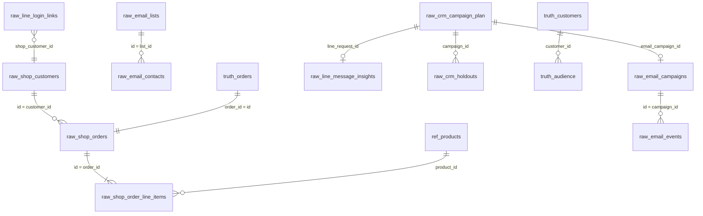

# Data model

One DuckDB file, one schema per system. The `raw_*` schemas only hold what each tool would really expose; joining them is the job of the warehouse built in the next step. The `truth` schema is the answer key.

## How the systems identify a person

| System | Key | Joins to the shop by |
|---|---|---|
| Shop (`raw_shop`) | `customers.id` | itself; `orders.email` too |
| E-mail tool (`raw_email`) | `contacts.id`, events by `email` | e-mail address, **after** `lower(trim())`: about 2 % are stored differently |
| LINE (`raw_line`) | `user_id` (U + 32 hex) | `login_links` only, about 70 % of friends; the others are anonymous |
| CRM plan (`raw_crm`) | `campaign_id` | holdouts are listed with each system's own identifier |

LINE statistics are **aggregates per message**, as in the real Messaging API: no per-user opens or clicks. Per-user behaviour on LINE only appears in `truth.audience`.

## How a campaign links to an order

The shop only knows `landing_site`, for example `/ja?utm_source=line&utm_medium=line_message&utm_campaign=jp-412-event`. The `utm_campaign` holds the market, the plan `campaign_id` and the theme. That is last-click attribution, with its blind spots:

- a click whose UTM got lost (other device, in-app browser) leaves no trace;
- a customer who would have bought anyway may click the message on the way;
- a message that was read but not clicked can still have an effect.

`truth.orders` gives the real `cause` (`organic` or `campaign_incremental`), the `causing_campaign_id`, and whether the UTM came from an `intent_click`.

## Main tables

| Table | Grain | Notes |
|---|---|---|
| `ref.calendar_events` | event × market | public holidays and commercial moments, with `demand_uplift` and `discount_code` |
| `raw_shop.orders` | order | `created_at` in UTC, `created_at_local` in the market's time zone; money in local currency |
| `raw_email.campaigns` | campaign | Brevo `globalStats` fields: `unique_views = trackable_views + apple_mpp_opens` |
| `raw_email.events` | event | `delivered`, `opened` (machine opens included), `clicked`, `unsubscribed`, `hard_bounce`, `soft_bounce`, `spam` |
| `raw_line.followers_daily` | account × day | `followers = targeted_reaches + blocks` |
| `raw_line.webhook_events` | event | `follow` / `unfollow` with the LINE user id |
| `raw_crm.holdouts` | campaign × person | people deliberately not messaged, to measure the real effect |
| `truth.audience` | campaign × person | every planned message: holdout, delivered, human open, machine open, click, opt-out |
| `truth.customers` | person | hidden traits: engagement, purchase propensity, lifetime, favourite category |
| `truth.parameters` | run | every parameter of the scenario, as JSON |
